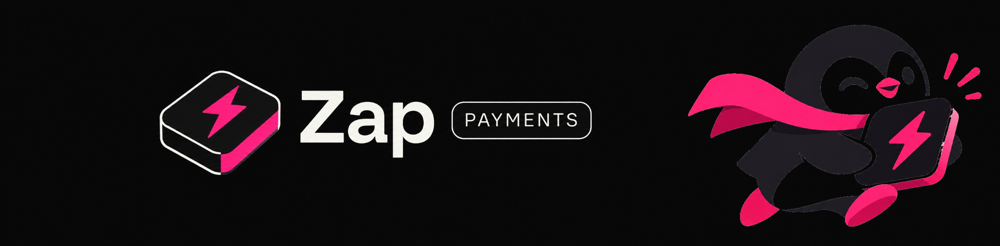

<p align="center">
  
</p>

<h1 align="center">Pay in any coin, on any chain. The seller gets USDC. The receipt holds the money.</h1>

<p align="center">
  <a href="https://nearhackathon.com/"></a>
  
  
</p>

<p align="center">
  <a href="https://zap-2lcs3sivbq-uc.a.run.app"></a>
  <a href="https://nearblocks.io/address/checkout.aakash7777.near"></a>
  <a href="LICENSE"></a>
  
  
  
</p>

> Built solo at [NEAR HACKATHON](https://nearhackathon.com/) (1–14 Nov 2026). Tracks: **Real-World Money**, **NFTs That Do Something**.

| | |
|---|---|
| **Repo** | https://github.com/mallikaakash/Zap |
| **Live app (NEAR mainnet, real money)** | https://zap-2lcs3sivbq-uc.a.run.app |
| **Receipt contract (mainnet)** | [`checkout.aakash7777.near`](https://nearblocks.io/address/checkout.aakash7777.near) |
| **Demo video** | _coming — see [Demo video](#demo-video)_ |
| **Demo post on X** | _coming — link lands here once posted_ |
| **Try it locally, no keys** | `pnpm install && pnpm demo` — see [Try it](#try-it) |

Hackathon prototype. Unaudited. Not a licensed money service. Funds are held by a public contract, not by a company.

---

## About the project

Every indie seller I know has the same two-line wish: *"let me paste a button on my page and get paid."* Stripe nailed that for cards. Crypto never did — you either take one coin on one chain (and lose everyone else), or you bolt on a bridge, a swap, a wallet connect flow and three modals, and the customer leaves (_I've been that customer_).

And refunds? In crypto, refunds are a DM and a prayer.

**Zap** is a checkout gateway for exactly that seller — the Carrd / Gumroad / no-code person with a product and no backend. It is two lines of HTML:

```html
<script src="https://zap-2lcs3sivbq-uc.a.run.app/pay.js" defer></script>
<pay-button merchant="your-shop.near" product-id="PRODUCT_ID" product="Pro plan"></pay-button>
```

The customer pays with **whatever coin they already hold, on whatever chain it lives on** — USDT on Polygon, ETH on Arbitrum, SOL, BTC. **NEAR Intents** swaps it into USDC on NEAR. The USDC does not go to the seller yet — it goes into a **receipt NFT** (NEP-171) that *holds the money* for the refund window. When the window closes, the seller gets paid. If something went wrong, an AI refund assistant (running on **NEAR AI Cloud**, private inference) looks at the complaint and the receipt and proposes a refund — and the refund goes back out through Intents to the **same coin and the same chain** the customer paid with.

So the receipt is not a JPEG. The receipt *is* the escrow. The receipt *is* the refund policy. Ownership with behaviour — which is, not coincidentally, what the NFT track asked for. And "merchant payments a normal company could use tomorrow" is the Real-World Money brief almost word for word.

Cool, but who is this actually for? Three people:

- **The seller** — gives a payout address, gets a button, gets emails and a dashboard. No wallet popups, no contract deploys. The operator registers the shop on chain for them.
- **The customer** — pays with what they have. No new wallet, no bridging, no "switch network". If the thing is broken they ask for a refund in a chat box, not a Discord ticket.
- **The judge / screener** — runs `pnpm demo` and sees all of it in ~2 minutes with no API keys. (_That's you. Scroll to [Try it](#try-it)._)

---

## Demo video

> 🎥 **[Demo video — placeholder, link goes here]**
>
> The story in the video: a seller adds Zap to a plain HTML shop by pasting one prompt into a coding agent, a customer pays $1 with USDT on Polygon via MetaMask, the money lands in a receipt on NEAR mainnet, the customer reports a broken feature, the refund assistant approves it, and the USDT comes back to MetaMask.

---

## Cool, but how does it actually work?

Let's walk a single dollar through the system.

**1. Checkout.** The `<pay-button>` opens a hosted checkout. The customer picks a coin and a chain. Zap asks NEAR Intents' **1Click API** for a quote: "deliver *N* USDC to `checkout.aakash7777.near` with memo *X*". The customer sends the coin to the deposit address 1Click returns. The customer's **browser** generates an ed25519 keypair — the **receipt key** — and only the public half ever leaves the browser.

**2. Settlement.** Intents does the swap and delivers USDC on NEAR. Here's the annoying bit — the USDC arrives with no order id attached. So the **settlement worker** watches the contract's USDC balance, attributes each deposit to its pending order, and calls `mint_receipt`. The contract refuses to assign the same USDC to two receipts. [`/verify/:id`](https://zap-2lcs3sivbq-uc.a.run.app/verify) shows that attribution so anyone can check it.

**3. The receipt.** `mint_receipt` mints a NEP-171 token. The token carries: the merchant, the amount, the refund window, the customer's refund target (chain + asset + address), and the receipt public key. The USDC stays **inside the contract**, bound to that token. Status is derived, not stored — `Held`, `PartiallyReleased`, `Released`, `PartiallyRefunded`, `Refunded` — straight from the `amount / released / refunded` triple (interface in [contracts/INTERFACE.md](contracts/INTERFACE.md)).

**4. Release.** The refund window ends. The worker calls `release`. Seller gets USDC. Done — the boring path, which is the path 95% of payments should take.

**5. Refund.** Customer opens the receipt page and writes "the export feature doesn't work". The **refund agent** (NEAR AI Cloud, `DeepSeek-V3.1` by default — swappable) reads the complaint, asks for a screenshot if it needs one, and *proposes* a decision. Proposing is all it can do — hard limits (max amount, window, daily cap) come from the merchant's **on-chain** config, not from the model. The decision is signed and relayed to the contract. Only once the contract has approved a refund, and only for the approved amount, can the worker push USDC back out through Intents to the original coin and chain.

Say hello to the part I'm most proud of — every action on an unclaimed receipt is a **signed receipt-key action**:

```
preimage = utf8("uc:v1|{contract_id}|{receipt_id}|{action}|{params}|{nonce}")
sig      = ed25519_sign(receipt_private_key, sha256(preimage))
```

The server relays it and pays gas (**meta-transaction** style). The contract verifies with `env::ed25519_verify` and bumps the nonce. So the customer never needs a NEAR account, never sees a wallet, and yet the server **cannot** request a refund on their behalf — it only holds the public key. Later, the customer can `claim` the receipt into a real NEAR account and it becomes a normal transferable NFT.

**6. Prepaid passes and milestones.** A receipt can be `OneTime`, `Subscription` or `Schedule`. A subscription receipt holds, say, 6 months of USDC with a release schedule; cancel it and the periods that haven't started come back, the periods already due stay with the seller. A milestone project releases per tranche. Same contract, same receipt, different schedule.

---

## What NEAR does here (concretely)

| NEAR piece | Where it's used | Why it matters |
|---|---|---|
| **NEAR Intents / 1Click** ([docs](https://docs.near-intents.org/)) | `packages/intents-adapter` | Pay-in from any chain → USDC on NEAR, and refund-out back to the same chain. Intents has no testnet, so the local demo uses a mock adapter; mainnet uses the real one. |
| **NEP-171 receipt NFT** | `contracts/receipts` (Rust, near-sdk 5.29) | The NFT *is* the escrow. It holds USDC, owns the refund state machine, enforces the window. |
| **`ft_on_transfer` (NEP-141)** | `contracts/receipts` | USDC arriving at the contract is what mints a receipt — no separate "deposit then mint" dance. |
| **ed25519 receipt keys + relayer** | `packages/chain`, `apps/web` | Walletless customers. Browser signs, server relays and pays gas, contract verifies. |
| **NEAR AI Cloud** ([cloud.near.ai](https://cloud.near.ai)) | `packages/core/src/refund-agent.ts` | Private inference for the refund assistant. The model proposes; the contract enforces. |
| **Function-call keys per role** | `executor.*`, `relayer.*` sub-accounts | The settlement worker is the only process with the executor key. The web app's relayer can approve refunds but cannot move money. |

---

## Try it

This is the path a screener should take. `pnpm demo` needs **no API keys, no wallet, no `.env`**.

Needs Node 22+ and pnpm. The first run downloads a local NEAR sandbox (about 60 MB). Rust is **not** required — the compiled contract is checked in under `contracts/artifacts`.

```bash
git clone https://github.com/mallikaakash/Zap.git
cd Zap
pnpm install
pnpm demo
```

The terminal prints four URLs when the app is up. Use those URLs. Then:

1. **Do:** open **Demo checkout**. Click a plan, pick any coin, enter a refund address, and press **Simulate payment**.
   **See:** a receipt. The amount is held. The page is marked **Simulated**.
2. **Do:** on that receipt, press **Request refund** and write that a feature is not working. When the assistant asks for a screenshot, attach any image.
   **See:** the assistant approves the refund.
3. **Do:** open the **Merchant dashboard** URL from the terminal and press **+1 min**.
   **See:** the refund completes and the held amount drops.
4. **Do:** buy the prepaid plan. On its receipt, claim it, transfer it, then cancel it.
   **See:** periods that have not started come back. Periods already due stay with the business.
5. **Do:** open **Dev inbox**.
   **See:** the emails the app would have sent.
6. **Do:** open `/verify/<receipt id>` for any receipt.
   **See:** the on-chain state of that receipt and how its USDC was attributed.

`pnpm test` runs the TypeScript tests. `pnpm test:contracts` runs the Rust tests (needs Rust). Stop the demo with Ctrl+C.

The demo shop is **Tallyfox**. It has a one-time plan, a prepaid pass, and a milestone project. Swaps are simulated. The refund assistant runs in deterministic `rules` mode when no NEAR AI key is set — same outputs, no network. The receipt contract on the sandbox is the **real contract**, not a stub.

### Seller onboarding (the two-line thing)

[`examples/seller-site/index.html`](examples/seller-site/index.html) is a plain page with those two lines. [`examples/demo-store/`](examples/demo-store/) is a slightly bigger SaaS pricing page that starts with **no payments at all** — the dashboard has a **Copy prompt for your AI** button, and pasting that prompt into Claude Code or Cursor adds the button and the signed-webhook endpoint. That's the onboarding story in the video.

The button is a convenience, never proof of payment. A seller with a server confirms `payment.succeeded` from the signed webhook (`X-UC-Signature`). A seller without one gets the email and the dashboard.

---

## Live mode (mainnet)

Live mode uses NEAR mainnet, real USDC, and real NEAR Intents. NEAR Intents has no testnet (hackathon rule Q-007), so the real swap can only be shown with real money. The hosted app at https://zap-2lcs3sivbq-uc.a.run.app is live mode — a test purchase costs the price plus about 1% in swap fees plus gas from your own wallet, and comes back on refund.

Mainnet payments are capped per receipt (default $50). The owner can pause new payments and releases; refunds still run while paused. Deploying or paying on mainnet is a human action, documented in [docs/GO-LIVE.md](docs/GO-LIVE.md). **A screening run should stop at `pnpm demo`.**

---

## Trust — what the contract guarantees and what it doesn't

- Intents delivers USDC with no order id. The settlement worker attributes the deposit and calls `mint_receipt`. The contract will not assign the same USDC to two receipts. `/verify/:id` shows that attribution.
- The worker can send a refund only after the contract has approved it, only for the approved amount, and only inside the daily cap. `/verify/:id` compares the quoted recipient with the refund address on the receipt.
- The AI only proposes. Amounts, windows and caps are read from on-chain merchant config and enforced before anything is signed. If the model's answer fails validation, the request escalates to the merchant — it never silently approves.
- For a shop registered by the operator, refund approvals in the dashboard are signed by the app's relayer. A merchant can take over by calling `register_merchant` from their own account.
- The contract is unaudited. This is a hackathon build. Threat model and open items: [docs/near/security.md](docs/near/security.md).

---

## Repo

| Path | What |
|---|---|
| `contracts/receipts` | Receipt contract: escrow, refunds, receipt-key signatures. Interface: [contracts/INTERFACE.md](contracts/INTERFACE.md) |
| `contracts/mock-usdc` | Faucet token for the sandbox |
| `packages/sdk` | `<pay-button>` custom element, built to `pay.js` |
| `packages/intents-adapter` | Real 1Click adapter and the local mock |
| `packages/chain` | NEAR client (`near-kit`) and receipt-key signing |
| `packages/core` | Sessions, merchants, receipts, refund agent, settlement, webhooks, email |
| `packages/db` | Prisma schema (SQLite, Litestream-replicated in prod) |
| `packages/landing` | The landing page rendered at `/` |
| `apps/web` | Next.js: checkout, receipt, verify, shop, dashboard, API |
| `services/settlement` | Worker. In live mode it is the only process with the executor key |
| `examples/seller-site` | A static page that embeds the button |
| `examples/demo-store` | A SaaS shop before and after the AI-prompt onboarding |
| `docs/` | [GO-LIVE.md](docs/GO-LIVE.md), [gcp-cloud-run.md](docs/gcp-cloud-run.md), a [NEAR knowledge base](docs/near/README.md), and brand assets in `docs/assets` |

---

## Built with / disclosures

Per the hackathon rules ([HACKATHON.md](https://nearhackathon.com/HACKATHON.md), Q-001 to Q-005):

- **Everything here was written in the window.** First commit 2026-11-11. No pre-hackathon code, no prior product on another chain.
- **Libraries:** `near-sdk` 5.29.1 (Rust), `near-kit` 0.20.2, Next.js, Prisma + SQLite, Litestream, `tsx`, vitest, Resend for email. NEAR Intents 1Click API without a JWT (0.2% fee, Q-006). NEAR AI Cloud for inference.
- **AI code:** a lot of it. Claude Code and Cursor were used throughout; the agent rules and skills they ran under are in the repo (`.cursor/`, `.agents/`). Design, contract interface, threat model and every decision about money are mine.
- **License:** MIT — see [LICENSE](LICENSE).
- **Other submissions by me:** none.

---

## Planned

- The merchant signs settings and refund decisions with their own wallet
- The refund chat uploads and reads the image. Today only the file name is stored
- Payouts on the merchant's own chain, not just USDC on NEAR
- The settlement worker inside a TEE, with attestation on `/verify`
- WooCommerce, Shopify, and MCP integrations

---

## TL;DR

Two lines of HTML give any seller a checkout that takes any coin on any chain. NEAR Intents turns it into USDC, a NEP-171 receipt NFT *holds* that USDC through the refund window, and an AI assistant on NEAR AI Cloud triages refunds inside limits the contract enforces — refunds go back to the customer's original coin and chain. Customers never touch a wallet; sellers never touch a contract. `pnpm demo` shows the whole thing locally with no keys.

<p align="center">
  <br/>
  <sub>Built with too much coffee at NEAR HACKATHON 2026 · <a href="https://github.com/mallikaakash/Zap">github.com/mallikaakash/Zap</a></sub>
</p>
